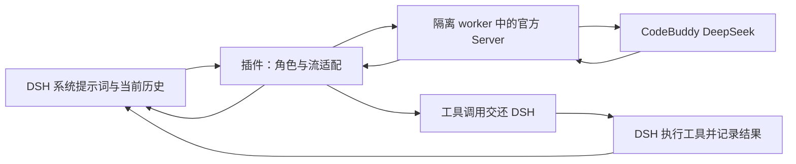

# 在 DSH 中使用 CodeBuddy 的 DeepSeek：改造全过程与测试方法

## 目标和当前状态

目标是在 DSH 中使用 CodeBuddy 账号额度，由 DSH 管理提示词、历史、压缩和工具，让 CodeBuddy SDK 对使用体验的影响尽量小，并取得可核查的 token 数据。

本轮清理超时修复、六小时实验和预算内真实调用已结束。**清理与长时稳定性验收通过；真实编程流程未完整验收，对照样本全部截断，不能认定编程能力与官方 API 等同。** 本地源码位于 `/data/ida/ai/dsh-codebuddy-sdk`，仓库为 `yf-river/dsh-codebuddy-sdk`。本轮不安装日常 profile，不提交、推送或发布。

本轮真实生成上限为 CodeBuddy 16 次、DeepSeek 官方 API 4 次。失败、摘要、重试均计数。此前完成的 8 次真实验收与更早历史台账分别保留，不能重置或挪作本轮额度。

## 为什么选择这个架构

用户希望尽量接近“DSH 直接调用官方 DeepSeek”，同时使用 CodeBuddy 额度。官方 DeepSeek API 本来就可以直接接入 DSH，因此单纯改用官方 API 不能满足额度目标。

早期 Session 方案让 CodeBuddy SDK 管理自己的会话；DSH 导入、编辑或压缩历史后，两边历史可能无法可靠对应。最终采用官方 CodeBuddy Server 的公开接口，每次提交 DSH 当前的完整角色历史。



实际业务工具由 DSH 执行；SDK 内部工具执行被拒绝。模型响应结束后停止 SDK 后续 agent 循环；公开 HTTP 宿主策略限制每次生成最多一个出站模型请求。账号认证使用公开 SDK 接口，不自行解密登录凭据，不使用私有模型网关。

这不等于消除了 CodeBuddy 的全部影响。用户消息包装、MCP 工具名前缀、部分 Schema 和参数默认值仍存在；服务端是否使用与官方 API 完全相同的模型部署，也不能仅凭模型名字认定。

## 改造与问题定位过程

| 阶段 | 发现与处理 | 证据边界 |
| --- | --- | --- |
| 目标确认 | 使用 CodeBuddy 额度，DSH 管理工作流，减少 SDK 干预 | 不承诺模型回答逐字相同 |
| Session 路线检查 | SDK 自有历史与 DSH 编辑、压缩后的历史难以可靠衔接 | 改用 DSH 当前历史作为真源 |
| Server 接入 | 公开认证、原生角色历史、MCP 工具声明、隔离 worker | SDK 和 Server 固定版本 |
| 压缩验收 | 先前短会话的摘要被截断，或比原文更长而被 DSH 拒绝 | 生成摘要不等于 DSH 实际采用摘要 |
| 日常缺陷修复 | 修复空回复误判成功、错误分类丢失、工作目录失效时等待不结束 | 对应单元和隔离集成验证 |
| 前轮真实验收 | 手动、自动压缩后续聊及重启后新工具执行通过，使用 8 次调用 | reasoning off、普通输出最多 512 token |
| 校验方法修正 | 真实摘要引用原文标记，曾被字符串判断误报成原文残留 | 改用原消息 ID 判断是否仍在请求中 |
| 清理超时审查 | 模拟 worker 已完成但不退出，暴露收尾缺少截止时间 | 不代表已复现真实 SDK 随机挂死 |
| 本轮修复回归 | 正常 SDK 工具收尾超过 5 秒，原先完成通知过晚会误杀正常请求 | 改由公开模型结束事件确认单次模型完成 |
| 进程组回归 | 主进程退出后，后代可能仍占用管道或尚未结束 | 强制终止后确认所属进程组无运行成员 |
| 浏览器预演 | 隔离回环环境会使 Chromium 报告离线，网页暂停连接 | 仅测试中设置联网提示，网络仍隔离 |

### 已完成的前轮真实验收

前轮 8 次包含六次普通生成、两次摘要。DSH/provider 返回口径：输入 69,038、输出 1,778，总计 70,816 token；人民币扣费未核账。请求模型 `deepseek-v4.1-flash`，服务报告 `deepseek-v4.1-flash-ioa`。

手动压缩将可见历史估算从 7,004 降至 1,154 token；两次摘要分别覆盖约 6,348、2,277 token 的旧片段。摘要保留关键事实，后续请求中的旧消息 ID 已被移除，重启后仍能回答并读取新文件。

## 为什么本地模拟有意义

本地模拟模型不是小型 DeepSeek，也不会理解问题。它是本机 HTTP 服务，按预设脚本返回模型协议数据。DSH、官方 SDK、IPC、工具执行、历史持久化与浏览器均真实运行；只有模型响应来自替身。

| 实验层次 | 真实部分 | 模拟部分 | 可以证明 |
| --- | --- | --- | --- |
| 子进程生命周期故障 | Node 子进程、IPC、进程组、信号与回收 | worker 完成、挂住、缺少通知等状态 | 是否有等待上限、误报成功、遗留后代 |
| 官方 SDK 集成 | DSH、官方 SDK/Server、历史和工具链 | 本地 SSE 响应、错误与延迟 | 协议、工具交接、错误传播、压缩后请求结构 |
| Web 检查 | 实际 DSH Web 与 Chromium | 本地模型；隔离环境的浏览器联网提示 | 选择模型、显示回复/工具/错误、刷新恢复 |
| 真实 CodeBuddy | 真实账号、服务与 DeepSeek 响应 | 仅使用隔离的测试项目 | 真实推理、编程、摘要采用和跨时段恢复 |
| 官方 API 对照 | 真实 DeepSeek 官方 API | 相同的冻结题目与评分器 | 有限样本中的可观察差异 |

模拟特别适合制造难以重复的异常，例如输出一半断开、工具 JSON 损坏、取消与完成同时发生、子进程不退出。发现问题后可以稳定重现，修复前后比较，不需要反复消耗模型额度。

固定返回正确答案不能证明模型能力。模拟摘要中出现预设口令，也不能证明真实模型会记忆。因而模拟结果和真实结果分开报告，不把运行时间长或固定回答正确当成质量证明。

## 本轮实验设计

### 清理超时

收到公开的模型结束事件后，由 worker 确认单次模型完成。父进程给予最多 5 秒清理时间；超过期限仅终止本次拥有的进程组，再给予最多 1 秒确认退出。完整回答经校验、强制清理成功时正常交付，诊断记录清理方式和耗时；无法确认退出则明确报错，不触发模型重试。

完成通知缺失、外部取消、异常退出和清理抛错分别验证。完成、取消与超时只能结算一次。插件卸载须等待 adapter 清理 Promise，不能提前结束清理过程。

### 六小时持续实验

- 两个 DSH 进程、四个会话轮换；一个进程持续运行，另一个定期重启。
- 默认每约 30 秒推进一次，目标至少 600 次本地生成，最多 1,000 次；失败和覆盖不足如实报告。
- 故障矩阵覆盖认证、额度、限流、服务错误、网络中断、空回复、拒绝、截断、损坏工具、分块 Unicode、延迟和大响应。
- 反复操作工具、压缩和恢复，检查消息与工具结果对应关系。
- 每分钟记录资源；驱动自身与 DSH/SDK 的内存分开统计，按实际拥有的进程判断清理情况。
- 开始、中段、结束各检查一次 Web。只回环网络下的联网提示修正单独注明，不把它当作真实断网重连验证。
- 真实调用阶段通过暂停握手让离线生成暂时停下，避免两边同时增加负载。

### 真实调用与同题对照

CodeBuddy 最多 16 次：连续编程 8 次、摘要 2 次、恢复追问 2 次、配对题 4 次。官方 API 最多 4 次。输出最多 4,096 token，单次 DSH 请求内容最多 64 KiB。标题生成等无关请求关闭，超预算在发送前拒绝。

真实调用分布在实验开始、中段和接近结束阶段。使用 high 推理、实际文件修改和测试；模型不得修改评分测试。官方 Key 已通过非生成的模型目录查询，官方路由为 `deepseek-flash`，目录名称 DeepSeek-V4.1-Flash。本机 DSH 账号凭据属于另一条通道，不冒充官方 API 对照。

配对题包括异步任务队列和 UTF-16 文本编辑；每题两次，两个通道使用相同系统提示词、题目、输出上限和行为测试。评分器在调用模型前用参考实现和错误实现验证。参考实现不提供给模型。只使用行为测试和格式检查评分，不额外花额度调用模型打分。

四组样本不足以证明整体能力等价；输出被 token 上限截断、失败、耗时和 token 都单独记录。

## 凭据、规则与费用

官方 API Key 只用于本次隔离实验的凭据文件，权限 0600；不写入仓库、日志、安装包或本文，结束后删除本次创建的凭据文件。原 CodeBuddy 登录态和日常 DSH profile 不修改。

[CodeBuddy SDK 文档](https://www.codebuddy.cn/docs/cli/sdk)说明已有 CLI 登录可被 SDK 使用，并提供编程调用及自定义配置能力。[服务协议](https://www.codebuddy.cn/agreement/)还对账号保管、对外服务和未经授权的修改/插件使用设有约束。实验记录接入方式与适用边界，不将“公开接口能调用”当作官方对本插件的个案合规确认。本次为本人账号、本机测试，不对外转售或提供服务。

[CodeBuddy Credits 文档](https://www.codebuddy.ai/docs/ide/Account/credits)说明额度消耗与模型、任务和上下文有关。因此 token 数不直接等于人民币。没有取得账单证据时保留“未核账”，不按 token 猜测费用。

## 复现与结果

源码仓库中的入口：`npm run test:ci`、`npm run test:integration`；持续实验通过 `scripts/test-sdk.mjs` 的 `CODEBUDDY_SOAK_DURATION_MS` 等测试环境变量配置。`scripts/long-live.mjs --preflight` 只校验模型与配置；真实调度需显式 `--run`。

运行台账与资源记录位于仓库 `artifacts/long-experiment/`、`artifacts/sdk-soak/`。本目录 `evidence/` 已保存精简的最终证据、资源采样和检查报告。历史失败记录保留，不能通过删除台账、换目录或重置计数重复消耗额度。

| 本轮检查 | 当前结果 |
| --- | --- |
| 官方模型目录与两条 DSH provider 初始化 | PASS，0 次真实生成 |
| 清理超时专项 | PASS，7 项生命周期回归；插件卸载等待清理另有专项检查 |
| 完整回归 | PASS，38 项单元检查、20 项完整隔离集成；冻结哈希已记录 |
| 六小时持续实验 | PASS，2026-10-26 21:54:39 至次日 03:55:31（北京时间），981 次本地生成，含静置与真实调用暂停 |
| 本轮真实 CodeBuddy 与官方对照 | PARTIAL，CodeBuddy 12/16、官方 4/4；手动/自动摘要与恢复通过，编程流程未完整结束，8 份对照输出均截断 |
| 安装包与最终结论 | 本地包见下文；未安装日常 profile、未提交、推送或发布 |

### 首段真实运行记录

首段编程调用先读取文件，下一次生成达到 4096 token 上限；完整工具调用未形成，固定行为测试失败，任务未完成。该结果保留为失败，不增加输出预算或追加重试。随后一份真实摘要被 DSH 采用，追问正确返回验收口令。

截断请求在公开模型结束后发生清理超时；插件约 5080 ms 后完成强制清理，回传 `max-tokens` 终态和 token 计数。其余三次正常清理约 128–148 ms。该证据说明此次真实请求没有无限等待，不能据此推断所有 SDK 清理异常均已发生或均会如此。

### 中段真实验收与节奏调整

第三小时的真实编程成功写入文本编辑实现，冻结的 5 项行为测试全部通过，评分测试没有被模型修改。下一次模型请求因 DSH 请求超过实验的 64 KiB 输入上限，在发送前被拒绝；因此整轮编程仍记为未完成。随后同一会话重启、自动摘要采用、验收口令恢复通过。当前 CodeBuddy 共 8 次，含两次摘要和两次恢复，未增加预算或重试。

按前半段的实际生成速度，原节奏可能提前触及 1000 次本地生成上限。第三小时之后加入一次 20 分钟静置资源观测，使用原有暂停握手，DSH 进程持续运行，资源仍每分钟采集，停止新生成。生产代码与冻结哈希不变，控制动作和前后状态保存在 `resource-observation.json`。最终六小时包含这段静置及真实调用暂停，不能描述为六小时连续满负荷生成。

## 最终结果与使用判断

清理超时缺口已修复，且本轮 5 次真实 CodeBuddy 请求实际触发了强制清理，约 5.07–5.08 秒后确认所属进程组结束并回传正确的截断终态。其余真实请求正常收尾。完整回答/工具参数的校验、用户取消和无法确认退出时的失败语义均保留。

六小时实验通过：963 次原生 DSH/SDK 本地生成，加三轮 Web 的 18 次，共 981 次；完成 666 项操作、55 次手动摘要、222 次自动摘要、5 次定时重启，覆盖 121 次预期故障。预期故障是故意制造且正确处理的错误；新增失败为 0。起点、中段、终点各 6 项网页检查全部通过。结束时没有仍在运行的所属子进程。正式计时约 6 小时 52 秒，包含 20 分钟静置、真实调用暂停与末轮网页检查，不是六小时连续生成。

361 次资源采样均未发现脱离进程树的运行子进程。持续运行的 DSH 进程按小时统计如下，内存没有呈现连续上升趋势，预热后文件描述符固定为 25。测试驱动自身保留通知，内存由第一小时中位数 106.1 MiB 增至第六小时 124.4 MiB，须与插件进程区分；这不等于证明没有任何内存泄漏。

| 小时 | 持续 DSH 内存中位数（MiB） | DSH 文件描述符范围 | 测试驱动内存中位数（MiB） |
| --- | ---: | ---: | ---: |
| 1 | 201.3 | 23–25 | 106.1 |
| 2 | 209.3 | 25 | 113.2 |
| 3 | 207.4 | 25 | 116.0 |
| 4 | 209.6 | 25 | 118.0 |
| 5 | 213.1 | 25 | 119.5 |
| 6 | 209.4 | 25 | 124.4 |

### 真实调用及 token 对账

| 通道 | 本轮调用/授权上限 | 未缓存输入 | 缓存读取 | 输出 | 总 token |
| --- | ---: | ---: | ---: | ---: | ---: |
| CodeBuddy | 12/16 | 79,228 | 0 | 25,628 | 104,856 |
| DeepSeek 官方 API | 4/4 | 2,382 | 1,536 | 16,384 | 20,302 |

缓存写入计数均为 0。官方总输入为 3,918 token，包含缓存读取；不能只用未缓存输入与 CodeBuddy 作输入长度比较。合计 125,158 token；人民币扣费未核账。更早的 8 次及其它历史台账不包含在此表中，原文件哈希未改变。

CodeBuddy 请求模型为 `deepseek-v4.1-flash`，服务报告 `deepseek-v4.1-flash-ioa`；官方请求模型为 `deepseek-flash`，模型目录名称为 DeepSeek-V4.1-Flash。目录名称相近不能证明部署和默认参数一致。

4096 token 和 64 KiB 是本轮实验的预算保护，不是插件日常使用的固定上限；本地预算拒绝不代表模型或 DSH 只能处理这些长度。

首段编程被 4096 token 输出上限截断，固定测试 0/5；中段代码通过 5/5，但后续请求超过 64 KiB 被本地预算保护拦下，模型没有完成运行测试和最后答复的整轮流程。真实手动摘要、自动摘要采用以及对应继续回答和重启恢复均通过。

同题对照的 8 份输出全部以 `max-tokens` 结束，JSON 不完整，未进入行为评分。**这批题目在 high 推理、4096 token 的限制下没有产生完整的可评分样本；它不能证明两边能力相同，也不能证明某一边编程更差。** 不修补输出冒充模型完成，不追加预算，不用剩余 CodeBuddy 次数替代已用完的官方对照额度。

结论是：列出的文本、工具、压缩、恢复和清理边界有了较充分的运行证据，可以作为后续日常试用的依据；复杂编程完整流程和官方 API 质量等价仍未验收。若以后继续质量对照，应另行明确预算，并选择能在输出上限内完成的题目，或允许更大的单次输出。当前公开 SDK 包装和服务端配置差异仍存在，不能承诺完全相同表现。

### 证据与复现

- [完整机器证据](evidence/long-evidence.json)：版本、冻结哈希核对、真实调用用量、终态与评分结果。
- [六小时报告](evidence/soak-report.json)、[每分钟资源采样](evidence/resources.jsonl)。
- [38 项单元检查](evidence/unit-final.tap)、[20 项完整集成检查](evidence/integration-report.json)。
- 三轮浏览器：[起点](evidence/web-start.json)、[中段](evidence/web-middle.json)、[终点](evidence/web-end.json)。
- [20 分钟静置观测](evidence/resource-observation.json)。

本地离线长测入口如下；模型为本地脚本，官方 SDK/DSH 真实运行。正式这轮另在第 212 分钟附近使用 `artifacts/long-experiment/resource-observation.mjs` 暂停新生成 20 分钟；真实调度也有单独暂停握手。复现时必须保留这些暂停记录，或使用更慢节奏并说明差异，避免超过 1000 次上限。

```sh
cd /data/ida/ai/dsh-codebuddy-sdk
PATH=/usr/local/n/versions/node/24.11.1/bin:$PATH \
CODEBUDDY_SOAK_DURATION_MS=21600000 \
CODEBUDDY_SOAK_TICK_MS=30000 \
CODEBUDDY_SOAK_MINIMUM=600 \
CODEBUDDY_SOAK_MAXIMUM=1000 \
node scripts/test-sdk.mjs
```

已有正式输出目录与真实台账应归档保留，不混合追加新实验。`scripts/long-live.mjs --run` 有已运行保护，不能把删除保护或重置台账当成重跑授权。官方 API 临时 key 文件及本次官方 profile 凭据均已删除；本机 CodeBuddy 登录态和日常 Web 服务未改动。

### 本地安装包

本地包 `/data/ida/ai/dsh-codebuddy-sdk/artifacts/long-package/dsh-codebuddy-sdk-0.1.5.tgz`，共 38 个文件、45300 字节，SHA-256：`f960935ae5e34be4e1b3b5819c32a649c2f9e1353a3fd66c086b210d6653e7bd`。打包内容已核对 runtime、worker 和验收文档；不含测试脚本、运行 artifacts 或凭据。见 [安装包核对](evidence/package-audit.json)。未安装到日常 profile，未发布。

## 2026-10-27 后续：显示名、真实调用验收与本地安装

### 结论先说

- 插件在本地 DSH **已实测可用**：用临时 profile 跑真实生成返回 `CB_SMOKE_OK`。
- 模型显示名改为 `codebuddy-v4.1-flash`；模型 **id 仍是 `deepseek-v4.1-flash`**（id 来自 CodeBuddy 模型发现，改 id 会破坏解析）。
- 已装进日常 `web` profile 并加好配置，**重启 DSH Web 后**在模型选择器里可见；默认模型未改动，与现有 DeepSeek 路由并存。
- Multica 侧尚未接入：受管 profile 只装 `@multica-ai/dsh-runtime`，需要把插件打进 runtime 供给后才会生效。

### 插件改动

`src/index.ts` 的 `listModels` 增加 `displayName()`：`deepseek-*` 模型显示为 `codebuddy-<后缀>`，例如 `deepseek-v4.1-flash` → `codebuddy-v4.1-flash`；`id` 不变。

### 重新打包

```sh
cd /data/ida/ai/dsh-codebuddy-sdk
npm ci --ignore-scripts && npm run build && pnpm test:ci      # 38/38 通过
mkdir -p artifacts/local && npm pack --pack-destination artifacts/local
```

产物：`artifacts/local/dsh-codebuddy-sdk-0.1.5.tgz`（45483 字节，SHA-256 `567ae4346c7debeec219920aafb1205dd9665220dda732c223fa7f1896ad570f`）。
旧的 `artifacts/long-package/0.1.5.tgz` 是 03:57 的包，早于 08:18 的重构，作废。

### 本地真实调用验收（已完成）

```sh
dsh --profile cb-verify --from-default-profile headless
dsh plugin --profile cb-verify add /data/ida/ai/dsh-codebuddy-sdk/artifacts/local/dsh-codebuddy-sdk-0.1.5.tgz
```

`/root/.dsh/profiles/cb-verify/cordis.patch.yml`：

```yaml
- id: agent-default-model
  config:
    provider: codebuddy
    model: deepseek-v4.1-flash
- id: codebuddy
  config:
    model: deepseek-v4.1-flash
    maxTokens: 8192
```

执行 `dsh --profile cb-verify "只回复 CB_SMOKE_OK，不要调用任何工具。"`，输出 `CB_SMOKE_OK`（真实 CodeBuddy 额度，非夹具）。

### 日常 web profile 安装（已完成，重启后生效）

```sh
dsh -V                                   # 0.2.1-rc.3，满足插件要求
dsh plugin --profile web add /data/ida/ai/dsh-codebuddy-sdk/artifacts/local/dsh-codebuddy-sdk-0.1.5.tgz
```

`/root/.dsh/profiles/web/cordis.patch.yml` 末尾追加（备份 `cordis.patch.yml.bak-20261027-codebuddy`）：

```yaml
- id: codebuddy
  name: dsh-codebuddy-sdk
  config:
    model: deepseek-v4.1-flash
    maxTokens: 8192
```

**未改** `agent-default-model`（保持 `deepseek-account/deepseek-flash`），所以默认路由不变；重启后在模型选择器选 `codebuddy-v4.1-flash` 即可。

回滚：`dsh plugin --profile web remove dsh-codebuddy-sdk`，并恢复上面的 patch 备份。

### Multica 接入（待做）

Multica 的 DSH agent 跑在受管 profile `multica-managed-<sha24>`，bundles 只有 `@deepseek-ai/dsh-base` + `@multica-ai/dsh-runtime`，runtime 来自 release 内嵌的 `dsh-runtime-*.tgz`。接入步骤：

1. `packages/dsh-runtime/package.json` 增加依赖 `dsh-codebuddy-sdk`（离线用 `file:` 指向随包 vendored tgz）；
2. `packages/dsh-runtime/cordis.patch.yml` 的 `insert` 块增加 `id: codebuddy, name: dsh-codebuddy-sdk`；
3. `server/internal/daemon/dshbundle/bundle/` 放入插件 tgz，`dshbundle` 打包时一并收入；
4. 版本升到 0.3.3，`pnpm bundle:daemon` 重打 bundle 并更新 `manifest.json`；
5. 走一次发布到 int，建一个 DSH agent、model 设为 `codebuddy/deepseek-v4.1-flash`，跑真实任务验收；通过后再考虑生产。

回滚：回退 `packages/dsh-runtime` 到 0.3.2（不含插件），受管 profile 由 daemon 按 artifact 重建。

## 2026-10-27 16:xx：插件随 runtime 打进发布 + 测试环境模型可选

- DSH runtime 升 **0.3.3**（`packages/dsh-runtime/{package.json,compat.json,src/version.ts}` 三处同步），受管 profile 默认模型改为 `codebuddy/deepseek-v4.1-flash`，canary 不再需要 DeepSeek key。
- `build_dsh_runtime` 现在把 `server/internal/daemon/dshbundle/bundle/dsh-codebuddy-sdk-*.tgz` 复制进发布目录 `runtimes/dsh`，daemon 供给时逐个 `dsh plugin add --offline`；`supplyManagedDsh` 装有插件，失败即判供给失败。
- 「测试环境 Agent」不再写死两档：`testagents.Policy` 增加可选 `runtime`，只校验形状；设置页改为运行时 + 模型选择器，模型取自 `POST /api/runtimes/{id}/models`；`scripts/test-agent-models.mjs` 同步放宽。
- 已验证：`release-environments.test.py` 48 项通过；`dshbundle` 与 `testagents` 测试通过；views typecheck 与 `test-agents` 组件测试 2/2 通过；本地临时 profile 真实 key 冒烟 `CB_SMOKE_OK`（usage 6996/5）。
- 生产已发布 `e7ba30454`、`0518bc447`；插件进受管 profile 需等下一次发布（打包修复要先成为已安装 operations）。
